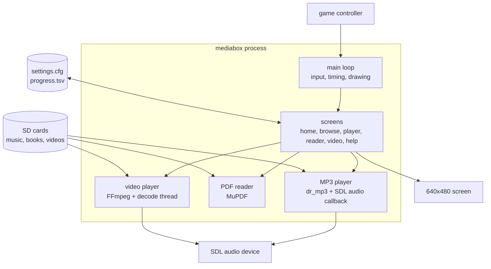
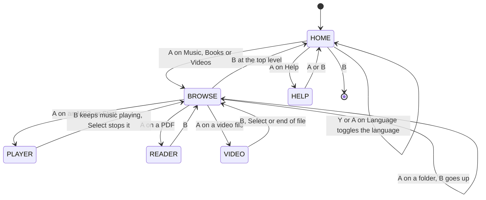
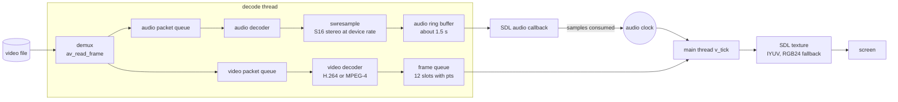
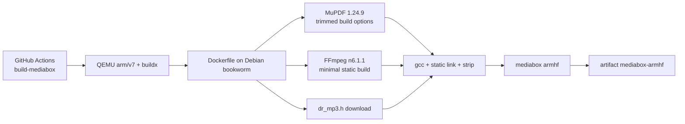

# mediabox architecture

This document describes how `src/mediabox.c` is put together: the screens, the players, the threads and how data
flows between them. It is meant for people who want to read, change or port the code. For usage see
[docs/USER_GUIDE.md](docs/USER_GUIDE.md), for how to contribute see [CONTRIBUTING.md](CONTRIBUTING.md).

## 1. Overview

- **One C source file** (`src/mediabox.c`, about 2000 lines), one process, no plugins.
- **SDL2** for window, renderer, audio device and game controller; **SDL2_ttf** for text. Both are loaded dynamically
  from the console's system libraries.
- **Statically linked into the binary:** MuPDF (PDF), a minimal FFmpeg (video demux/decode, audio decode, resampling,
  pixel conversion) and the single-header `dr_mp3` (MP3 decoding).
- **Fixed logical resolution 640x480** (`W`, `H`). `SDL_RenderSetLogicalSize` scales it if the real window differs.
- **Event-driven redraw:** the screen is only redrawn when a `dirty` flag is set (key press, timer tick, new video
  frame). This keeps CPU use low, which matters on the target hardware.



## 2. Source file map

The file is divided by banner comments (`/* ------- name */`). They appear in this order:

| Section | What lives there |
|---|---|
| header and constants | font paths, config paths, fallback gamepad mapping (`PAD_MAP`) |
| types | `EType` (list entry kinds), `Screen`, `Key` enums, `Entry` struct |
| global state | SDL objects, colors, browser state |
| language | `Lang`, the `STR` table indexed by `X_*` ids, `TX()`, settings load/save |
| helpers | `fill`, `draw_text` with its text cache, path and time helpers |
| drawing primitives | background gradient, rounded rectangles, circles, icons, pills, key hints |
| PDF progress record | `progress.tsv` read/write |
| browser | folder listing, categories, roots, going up |
| MP3 audio | `dr_mp3` decoder, SDL audio callback, playlist, seek |
| PDF reader | MuPDF context, page rendering, zoom and panning |
| video | everything about video (section 7) |
| screens | `draw_home`, `draw_browse`, `draw_help`, `draw_player`, `draw_screen` |
| input | key handling per screen, controller events, direction repeat |
| main | initialization, main loop, cleanup |

## 3. Screens and navigation

`Screen` is a small state machine. `draw_screen()` and `handle_key()` both switch on it.



The "now playing" bar at the bottom of HOME and BROWSE is drawn whenever an MP3 is loaded, so music survives while the
user browses or reads.

## 4. Main loop, input and redraw

```
init SDL, renderer, controller, fonts, settings, progress  ->  show_home()
while running:
    wait for an event (timeout: 5 ms in VIDEO, 20 ms while a direction is held, else 250 ms)
    handle events                         -> handle_key() sets dirty
    poll the d-pad / left stick           -> auto-repeat: first after 350 ms, then every 85 ms
    if VIDEO: v_tick()                    -> picks frames, decides when to quit
    if an MP3 ended: track_step()         -> next track
    every 500 ms while music shows: dirty = 1   (clock and progress bar)
    if dirty: draw_screen(); SDL_RenderPresent()
```

- **Controller:** `SDL_GameController` events (A, B, X, Y, shoulders, Start, Back, triggers). If the system did not
  provide a mapping, `PAD_MAP` (GA36-MB) is added at start. Directions are *polled* (`read_dirs`) so the auto-repeat
  timing is under the app's control. The keyboard (arrows, Enter, Escape) exists for testing only.
- **Key abstraction:** controller buttons become `Key` values (`K_A`, `K_B`, `K_L`, ...). `handle_key()` dispatches by
  `scr` to `reader_key`, `v_key`, the player block or the list code.

## 5. Browser and categories

- `Entry` = `{ name, path, type }`. `type` is a folder, a file kind (`T_MP3`, `T_PDF`, `T_VID`) or a home tile
  (`T_CAT_*`). The home screen is just five `Entry` items with tile types.
- `cat` selects the category: 0 music, 1 books, 2 videos. `open_category()` looks for
  `/home/player/<name>` and `/media/external/<name>`. With both present the user first picks **Internal** or
  **External** (`show_roots`); with one present it opens directly.
- `enter_dir()` lists a folder: dot-files hidden, extension hidden for files, folders first, case-insensitive sort
  (`cmp_ent`). Filters: music shows `.mp3` and video files, books show `.pdf`, videos show video files.
- `go_up()` walks to the parent, or back to roots/home, and re-selects the folder we came from.
- Selection restore: `home_sel` remembers the last home tile.

## 6. Audio and PDF

### MP3 player
- `dr_mp3` decodes **inside the SDL audio callback** (`audio_cb`): it reads PCM straight into SDL's buffer and bumps
  `cur_frames`. When the decoder runs dry the callback pads silence and sets `a_ended`; the main loop then calls
  `track_step()`.
- Seeking calls `drmp3_seek_to_pcm_frame` while holding `SDL_LockAudioDevice`, so the callback never sees a
  half-updated state. Elapsed time is `cur_frames / sample rate`.
- Playlist = all `.mp3` entries of the current folder, with repeat (off / list / one) and shuffle.
- The device is opened per track at the file's sample rate, 4096-sample buffer.

### PDF reader
- A MuPDF context with a 48 MB store. `reader_render()` renders **one page** into a pixmap and uploads it as a single
  RGB24 texture. The scale is capped by the renderer's maximum texture size and by about 8 megapixels.
- Zoom levels: fit page, fit width, 150 %, 200 %, 300 %. A texture larger than the screen is panned with `px`/`py`;
  reaching an edge flips the page.
- The page number is saved after each render in `progress.tsv` (`page<TAB>path`, newest 256 files kept).
- MuPDF errors use its `fz_try / fz_catch` exceptions; the UI shows a localized error instead of crashing.

## 7. Video player

Video is the only part that uses extra threads.

### 7.1 Threads

| Thread | Job | Shared state |
|---|---|---|
| main | input, drawing, picks frames by the clock (`v_tick`) | reads frame queue and clock under `v_mx` |
| decode | demux, decode video and audio, convert, fill the queues | writes frame queue and audio ring under `v_mx` |
| SDL audio callback | copies PCM from the ring to the sound device | reads ring, advances `v_consumed` under `v_mx` |

`v_mx` is one `pthread_mutex_t` that protects the frame queue, the audio ring and the clock counters.
`v_abort`, `v_seek_req` and `v_eof` are C11 atomics. Everything else belongs to a single thread.

### 7.2 Data flow



### 7.3 Why separate packet queues
Audio and video packets are interleaved in the file. A single loop that blocked whenever the video frame queue was full
stopped reading, so the audio packets lying *behind* the pending video data arrived too late and the sound stuttered.
Now the decode thread never blocks on a decoder: each pass it (1) decodes up to four audio packets if the ring has room,
(2) decodes one video packet if the frame queue has room, (3) demuxes up to four packets into the two queues
(limits: 3000 packets and 16 MB video, 4 MB audio), and (4) at end of file drains the decoders. If nothing was done it
sleeps 2 ms.

### 7.4 Clock, sync and dropping frames
- **Master clock = audio.** `clock = clock_base + consumed_samples / rate - device_latency`. Only real samples count,
  so an underrun pauses the picture instead of desyncing it.
- No audio track (or audio finished): a wall clock (`SDL_GetTicks`) takes over.
- `v_tick` takes every queued frame whose pts is due and shows the newest one; older due frames are dropped and counted
  (the **Dropped** pill).
- **Buffering state** at start and after a seek: playback starts when at least 3 frames and about 0.25 s of audio are
  ready, at end of file, or after 3 s at the latest.
- Frames that are not YUV420P are converted with swscale in the decode thread. The texture is `IYUV`; if the renderer
  cannot create one, an RGB24 texture plus a swscale conversion is used.
- Decoder settings for slow CPUs: 2 threads (frame and slice), `skip_loop_filter = AVDISCARD_NONREF`, `FLAG2_FAST`.

### 7.5 Seeking
1. The main thread sets `v_seek_to`, increments `v_seek_gen` (under the mutex), sets `v_seek_req` and enters buffering
   (`v_do_seek`; key handling is debounced by the scrub logic described in 7.6).
2. The decode thread notices the flag, calls `av_seek_frame` (backward to a key frame), flushes both decoders and
   resamples, clears both packet queues and the frame queue, resets the ring and sets the clock base.
3. It records `v_seek_done = generation`. Buffering ends only when `v_seek_done == v_seek_gen`, so stale frames of an
   older position are never shown. Frames and audio before the target are discarded (`v_discard_until`).

### 7.6 Scrub seeking, resume and system volume
- **Scrub seeking.** Left/Right/L/R do not seek immediately. `v_scrub()` accumulates a target (`v_scrub_acc`), the step
  grows with hold time (x1, x2, x4, x9 after 0.6 s, 1.6 s and 3.2 s), playback is paused and the overlay shows the
  target. After 450 ms without input (or on **A**) `v_scrub_commit_do()` performs one real seek through `v_do_seek()`.
  This avoids flushing the decoders on every key repeat.
- **Resume.** `video_progress.tsv` (`seconds<TAB>path`, newest 128) is read at start (`vprog_load`). `v_open` seeks to the
  saved position through the normal seek protocol before the decode thread starts and shows a notice. The position
  is written every 15 s, on exit and cleared at the end of the file (`v_save_pos`, `vprog_set`).
- **System volume.** `libasound.so.2` is loaded with `dlopen` (no build dependency). `sysvol_get/sysvol_set` open the
  default mixer, choose a playback control (`settings.cfg` `mixer=` override, else Master, Playback, PCM, Headphone,
  Line Out, Speaker, Digital, else the first one), read or write it and close it again. The main thread (`v_tick`) polls it
  every 0.8 s so changes made with the console's side buttons show up. Without ALSA the app uses its own gain in the
  audio callback.

### 7.7 Shutdown
`v_close()` sets `v_abort`, joins the decode thread, closes the audio device, frees queues, codecs, the format context
and textures. Starting a video first stops any MP3 playback (only one audio device is used at a time).

## 8. Rendering and text

- Renderer: accelerated with vsync, software as fallback. All drawing is 2D rectangles, circles, scanline triangles and
  text, built from `fill()` (with alpha) in `cizim ilkelleri`.
- Background: a 1x480 gradient texture stretched over the screen.
- `fill_rr` (rounded rectangle), `fill_circle`, `icon_*` (note, book, video, play, pause, prev, next), `pill`,
  `draw_hints` (bottom key chips, wraps to two rows).
- **Text cache:** `draw_text` keeps up to 128 rendered strings as textures, keyed by font, color and string, with LRU
  eviction. Without it every frame re-rasterized all labels, which was a noticeable cost on the video overlay.
- Long text is shortened with "..." to the requested width (UTF-8 safe).

## 9. Languages

- `Lang` (`L_EN`, `L_TR`), a global `lang`, and `STR[X_N][2]`: one row per message id (`X_*`), one column per language.
- `TX(id)` returns the string for the active language. Format strings (`%d`, `%s`) live in the table too.
- The choice is saved in `settings.cfg` (`lang=en|tr`); default is English. `lang_toggle()` flips it from the home screen.
- Text is UTF-8; the Inter font used on the console covers the Turkish letters.

## 10. Persistent files

| File | Content |
|---|---|
| `/home/player/.config/mediabox/settings.cfg` | `lang=en` or `lang=tr`, optional `mixer=NAME` |
| `/home/player/.config/mediabox/progress.tsv` | last page of each opened PDF |
| `/home/player/.config/mediabox/video_progress.tsv` | resume position (seconds) of each video |

## 11. Build pipeline



Only SDL2, SDL2_ttf, libm and libc remain dynamic, so the binary runs on the console without installing anything.
The Dockerfile prints the `NEEDED` libraries and the highest `GLIBC_*` symbol version at the end as a sanity check.

## 12. Limitations and design decisions

- **Software video decoding only.** No hardware decoder is used; HEVC, VP9 and AV1 are not built in.
- **One decode thread** for audio and video keeps the code simple; the packet queues make that safe.
- **No automated tests.** The app is verified on a device (see CONTRIBUTING.md for the checklist).
- **Paths and fonts are hard-coded** for goodluckOS; change the constants at the top of the file for other systems.
- **One audio device:** music and video are never active together.

## 13. Where to extend

| Goal | Start here |
|---|---|
| New file type or category | `EType`, `enter_dir` filters, `open_category`, `list_activate`, a new player or reader section |
| New screen | add to `Screen`, then `draw_screen`, `handle_key`, and the hints |
| New language or string | `STR` table and the `X_*` enum (see CONTRIBUTING.md) |
| Another video codec | add `--enable-decoder/parser/demuxer` flags in the `Dockerfile` FFmpeg `configure` |
| Different screen size | `W`, `H` and the layout numbers in the `cizim` sections |
